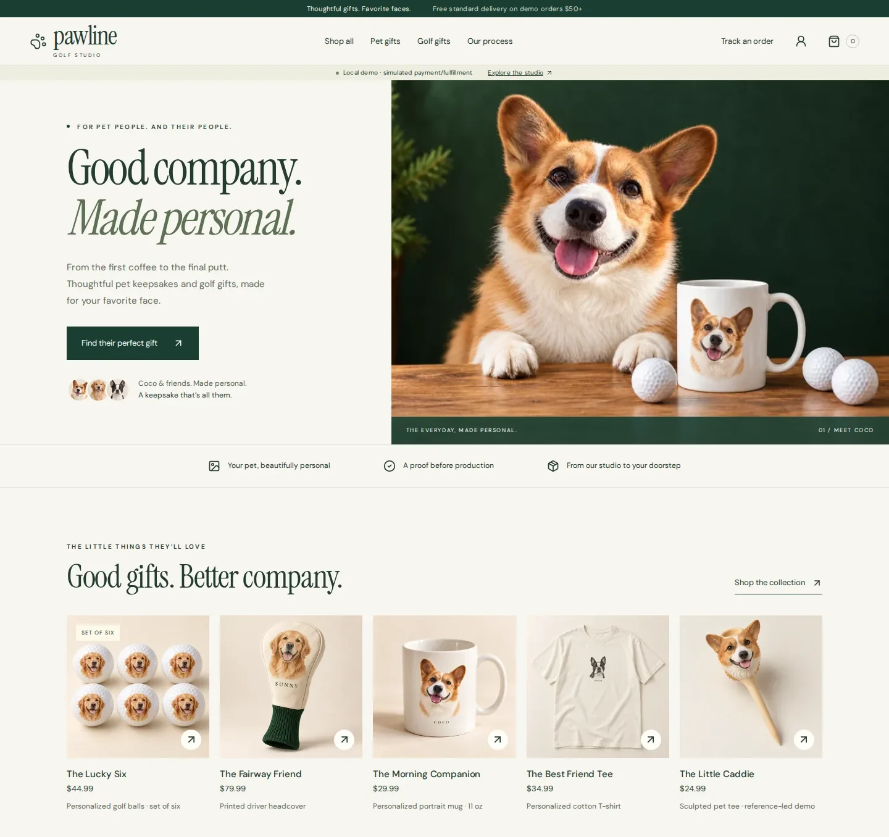
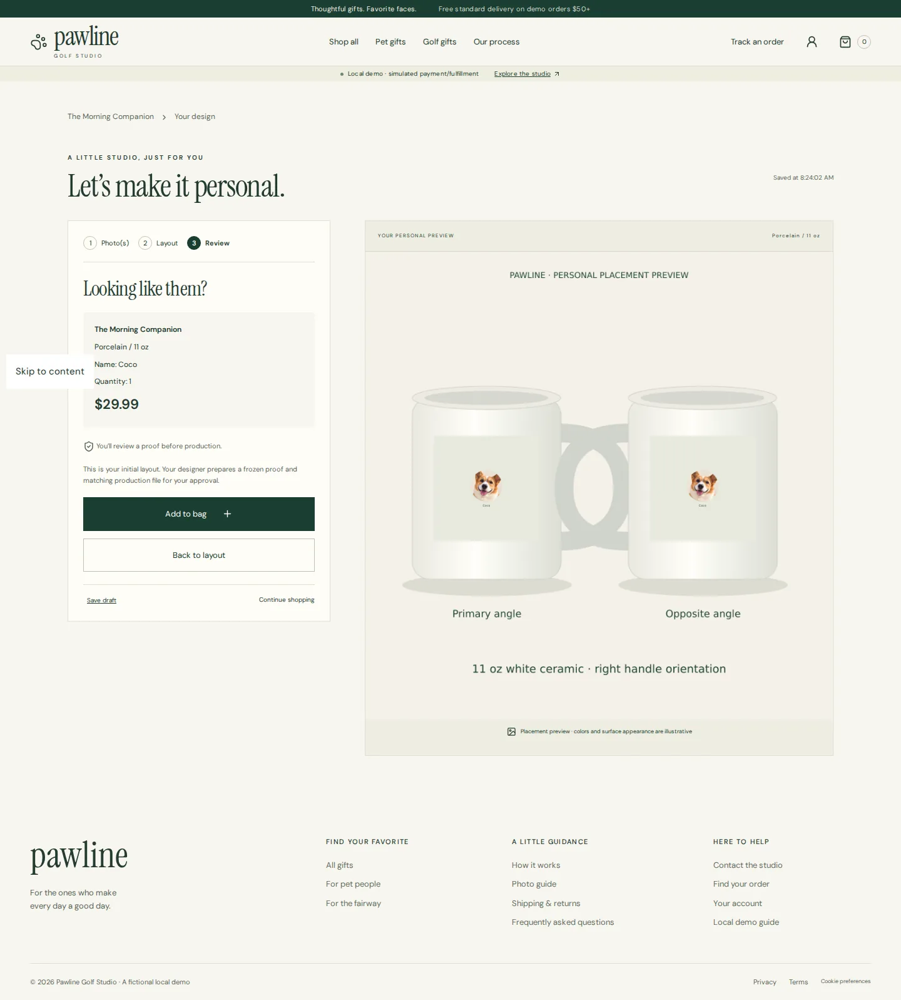
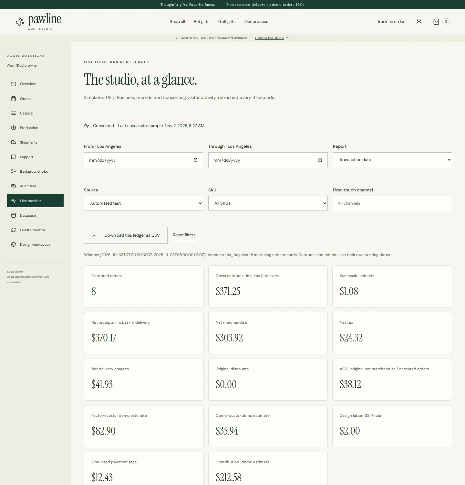
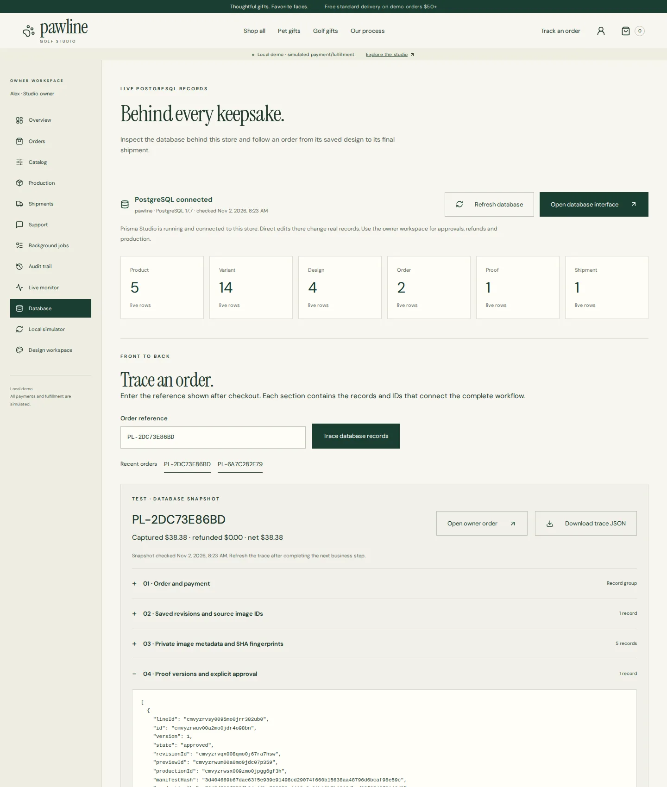

# Pawline

A custom pet-portrait gift store, built end to end as a pre-launch brand concept. This repository is an excerpt of that build: the data model, the business rules, the tests and the verification tooling.

The case study, with the design decisions and the verification results, is at [barryzehuizhang.com/work/pawline](https://barryzehuizhang.com/work/pawline/).

A customer uploads a pet photo, places it on a product and orders it. A designer turns the photo into a proof, the customer approves or asks for changes, and the owner releases the approved design to production and tracks it to delivery. The store carries that whole loop.

> **Status.** Pawline is my own concept and has not launched. Payments, the factory and shipping are local simulated ledgers, and prices and tax are demo values. Everything else ran for real in the full build: the web app, PostgreSQL, image upload and rendering, sign-in, proof approval, line-level refunds, background jobs, email and monitoring.

> **This is an excerpt.** The pages, the product catalog with its prices, and the brand imagery are not published, so the repository does not run as it stands. It is here to be read.

## Screens

| | |
| --- | --- |
|  |  |
|  |  |

## Where to start reading

| File | What it shows |
| --- | --- |
| `prisma/schema.prisma` | The data model: 33 tables for identity, catalog, personalization, cart and checkout, orders and payments, production and shipping, and operations |
| `src/domain/checkout.ts` | Cart, quote, payment attempt and capture. This is where 120 concurrent orders have to produce exactly 120 charges |
| `src/domain/refunds.ts` | Refunds by order line, with the allocation kept in the ledger |
| `src/domain/proofs.ts` | The designer queue, versioned proofs and the customer's decision on each one |
| `src/domain/fulfillment.ts` | Release to production, factory events, shipments and cancellation requests |
| `src/domain/monitor.ts` | Health probes, business metrics and the CSV export behind the owner's live monitor |
| `src/worker.ts` | The background job consumer |
| `tests/integration/ledger.test.ts` | Integration tests that run the domain commands against a real PostgreSQL |
| `tests/e2e/` | Browser tests: first order, checkout recovery, faults, restore, accessibility, security |
| `scripts/stress.mjs`, `scripts/fault-controller.sh`, `scripts/verify-restore.sh` | The load test, fault injection and the backup-and-restore check |
| `docs/sql/order-trace.sql` | The query that follows one order through every record it touched |

## How the full build was verified

Each run built an isolated Docker Compose project with its own ports, database, media and mail volumes.

- 117 automated tests: 14 unit, 20 integration tests against a real PostgreSQL, and 83 browser tests on Chromium, Firefox and WebKit.
- A load test of 25,898 requests, with read p95 between 20 and 53 ms.
- 120 concurrent orders produced exactly 120 charges, with no reservations left over.
- A forced kill of the web process recovered with the ledger unchanged.
- Backup and restore were checked file by file against recorded hashes.

Mobile layouts were checked in emulated viewports, and WebKit is not the same as Safari on a device. One browser spec that only checked brand imagery is left out of this excerpt.

## Layout

```
app/api, app/health   the API route and the health probes
src/domain/           ordering, design, proof review, fulfilment and monitoring rules
src/infra/            database access and the simulated payment, factory and carrier receipts
src/worker.ts         the background job consumer
prisma/               schema and migrations
scripts/              start, verify, backup, restore, fault-injection and load-test tooling
tests/                unit, PostgreSQL integration and browser tests
docs/sql/             SQL for the database overview and the order trace
docs/screens/         screenshots of the full build
```

## Stack

Next.js, React, TypeScript, PostgreSQL, Prisma, Playwright and Docker Compose.

This is a published snapshot, not a development history.

© Barry (Zehui) Zhang. Shared for portfolio review. Not licensed for reuse.
